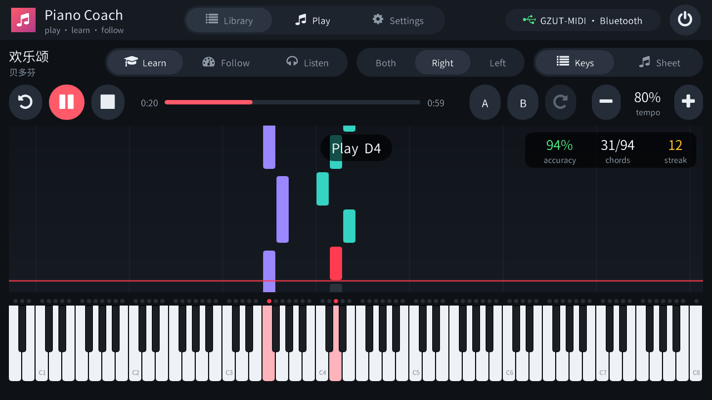
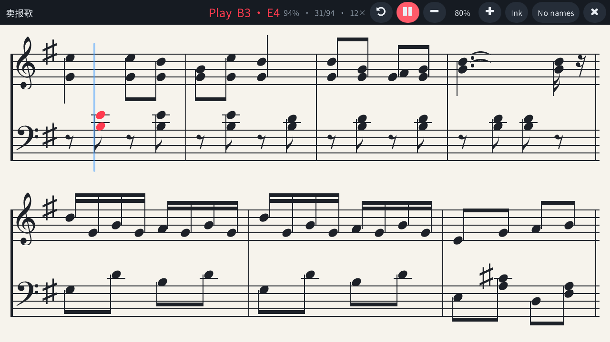
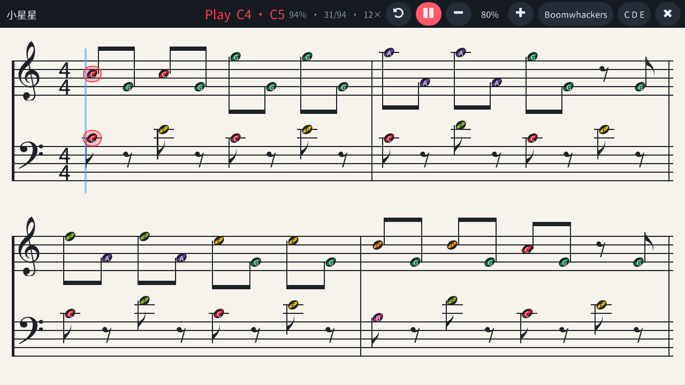
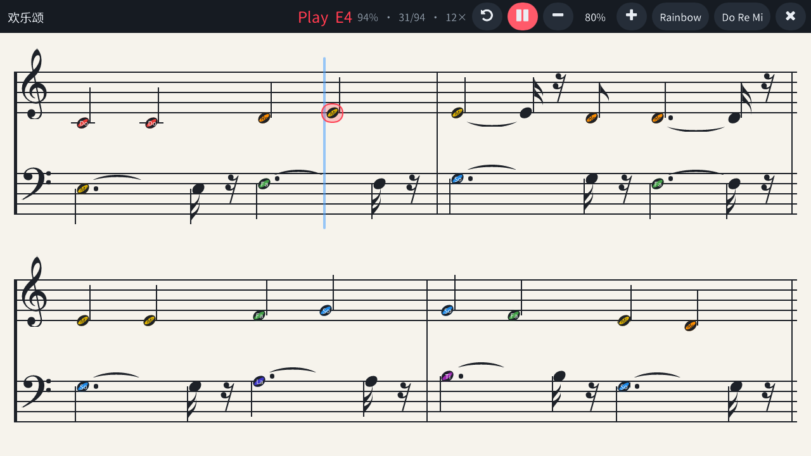
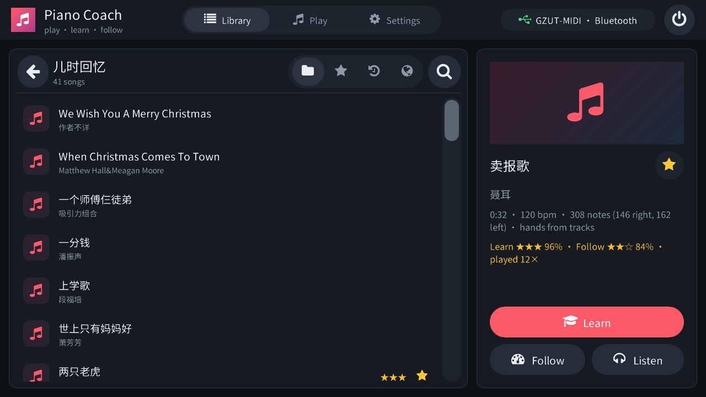
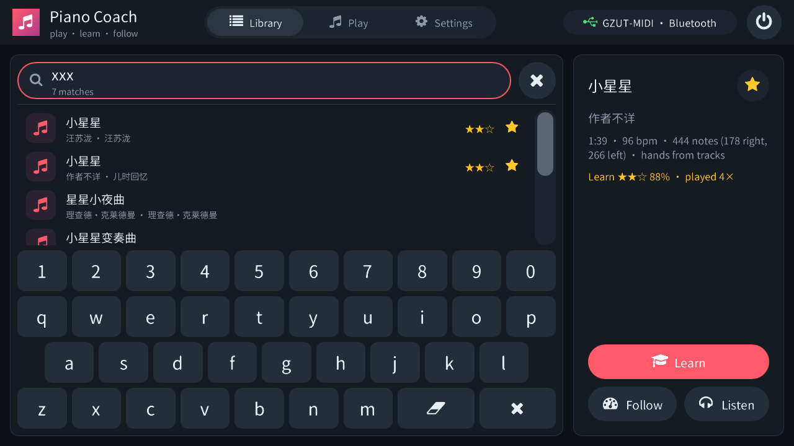
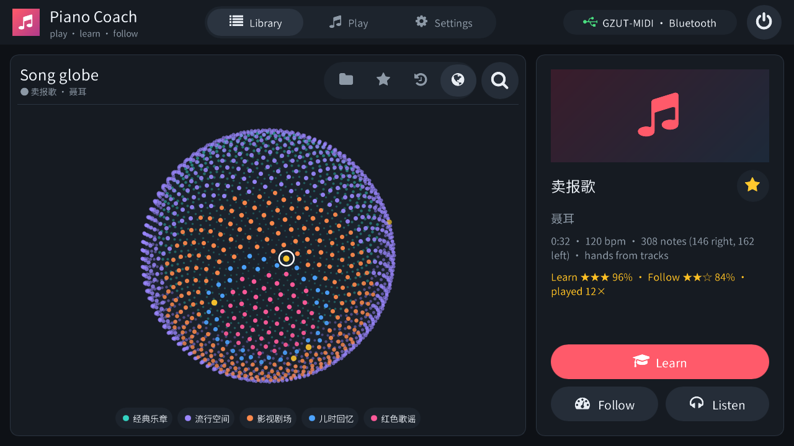
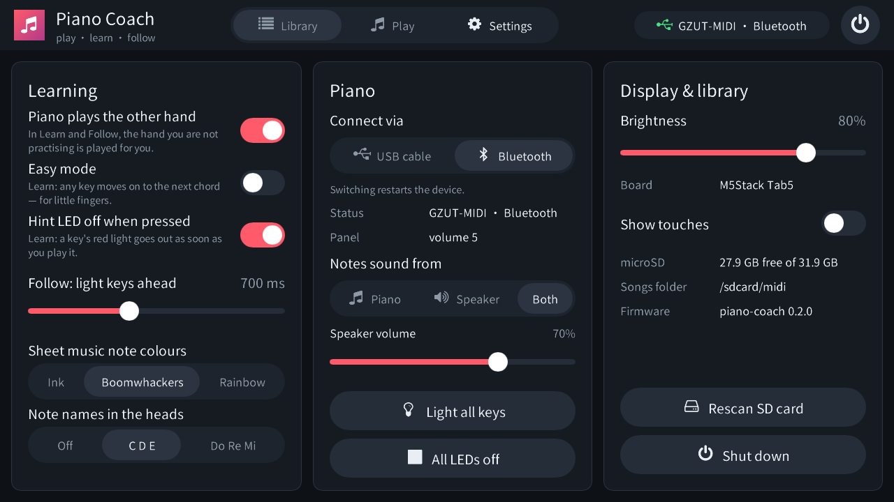
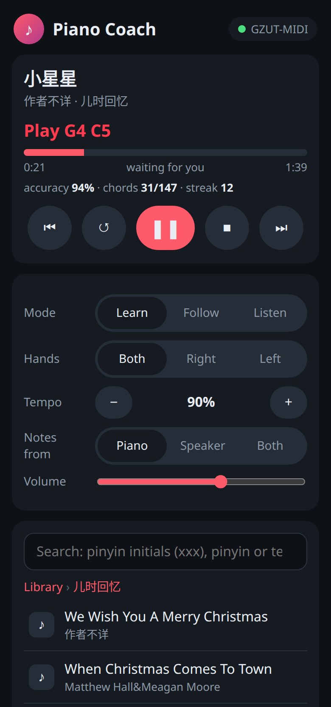
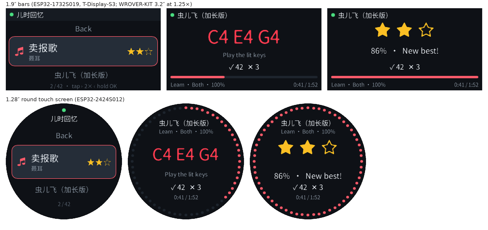

# piano_esp32

**Piano Coach** — Rust firmware for ESP32 boards that plays songs on the
GZUT 88-key LED digital piano and teaches them: the piano's red key lights
show what to play next and the song waits for you. Plus the reverse-engineered
piano protocol (USB `GZU-tek CHMidi-2.3`, BLE `GZUT-MIDI`, BT audio
`GZUT-MUSIC`).

## Features at a glance

| | |
|---|---|
| **Learn, Follow, Listen**<br>Learn lights the next chord on the piano and waits until you play it; Follow plays the song like Listen with the keys lit just ahead, and as soon as you join in with a hand that hand turns soft so you lead it (4 s without playing and it is loud again), scoring your timing; Listen plays the song on the piano. Practise either hand (the piano plays the other), slow down the tempo, loop a section (A–B), easy mode for small children. |  |
| **The piano is the remote**<br>Every board starts in Follow with a random children's song (儿时回忆) as soon as the piano connects. The lowest and highest keys are buttons: previous / next song and folder, random song, shuffle-play a whole folder, play / pause, restart, tempo, Learn / Follow / Listen, left / both / right hand, bookmark — whenever the song doesn't need those keys. | |
| **Sheet music, full screen**<br>A grand staff engraved from the MIDI file — clefs, key and time signatures, beams, rests, ties, accidentals — with a cursor following the music, the notes to play now in red and automatic page turns. |  |
| **Colour notation for beginners**<br>Note heads in **Boomwhackers** or **Rainbow** (Chroma-Notes style) colours, optionally with note names (C D E or Do Re Mi), to see patterns, pitches and intervals at a glance. |  |
| |  |
| **Song library**<br>2449 songs browsed from the microSD card by folder, with bookmarks, recently played, best-score stars and play counts. |  |
| **Search by pinyin**<br>Find any song by pinyin initials (`xxx` → 小星星), full pinyin or Latin text on the on-screen keyboard. |  |
| **Song globe**<br>Every song as a dot on a spinning 3D sphere, coloured by category — spin it and tap a dot to pick a song. |  |
| **Settings**<br>USB cable or Bluetooth, notes from the piano and/or the board's speaker (built-in piano synth), sheet colours and names, learning options, LED test, brightness, shut down. |  |
| **No screen? Use your phone**<br>On the ESP32-Audio-Kit and the YD-ESP32-S3 the board opens its own Wi-Fi network; join it and a page opens to browse, search and start songs and to set mode, hands, tempo and volume. Six keys and short tones work without a phone; the board's speaker can play the notes too. |  |
| **Small boards: minimal UI**<br>A three-row wheel menu and a big "what to play next" screen for 1.9″ bars and a 1.28″ round watch-like touch screen; songs stored in flash, piano over Bluetooth; one or two keys, touch, or the piano's own keys as remote control. |  |

## Supported boards

| Board | Chip | Display | Piano link | Songs |
|---|---|---|---|---|
| M5Stack Tab5 | ESP32-P4 | 5″ 1280×720 touch | USB-A or Bluetooth | microSD |
| ESP32-S31-Korvo-1 V1.1 | ESP32-S31 | 4.3″ 800×480 touch | USB-A or Bluetooth | microSD |
| ESP32-1732S019 | ESP32-S3 | 1.9″ 320×170 | Bluetooth | all 2449 in flash |
| LILYGO T-Display-S3 | ESP32-S3 | 1.9″ 320×170 (touch optional) | Bluetooth | all 2449 in flash |
| ESP-WROVER-KIT v4.1 | ESP32 | 3.2″ 320×240 | Bluetooth | 776 in flash |
| ESP32-2424S012C | ESP32-C3 | 1.28″ round 240×240 touch | Bluetooth | 776 in flash |
| Ai-Thinker ESP32-Audio-Kit | ESP32 + ES8388 | none — keys + phone web page | Bluetooth | microSD |
| ESP32-2432S028R ("Cheap Yellow Display") | ESP32 | 2.8″ 320×240 resistive touch | Bluetooth | 776 in flash |
| VCC-GND YD-ESP32-S3 | ESP32-S3 | none — BOOT key, RGB LED + phone web page | USB-C OTG and Bluetooth together | all 2449 in flash |

The screenshots are rendered on a PC by `firmware/piano-coach/tools/make_screenshots.sh`
with the firmware's own UI code, fonts and engraver from the real song library.

## Documents

* [AGENTS.md](AGENTS.md) — orientation for AI agents and new contributors:
  boards and ports, build/flash/test commands, hardware quirks, conventions.
* [doc/piano_coach_firmware.md](doc/piano_coach_firmware.md) — **Piano Coach**:
  using it, building and flashing every board, architecture, what was
  verified on hardware (`firmware/piano-coach`, `firmware/piano-core`;
  porting guide in [firmware/piano-coach/boards/README.md](firmware/piano-coach/boards/README.md)).
* [doc/GZUT_piano_protocol.md](doc/GZUT_piano_protocol.md) — USB and BLE
  MIDI protocol, LED control, vendor SysEx, BLE packet quirks, recipes
  for Linux/Python/ESP32.
* [doc/test_log_2026-10-15.md](doc/test_log_2026-10-15.md) — raw captures
  and live test results the protocol document is based on.

Quick start with the piano alone (USB, Linux):

```bash
amidi -p hw:3,0,0 -S '90 3C 01'
```

lights middle C silently; `80 3C 00` turns it off; `B0 7B 00` clears all.
